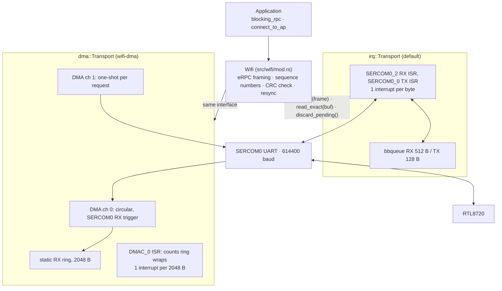
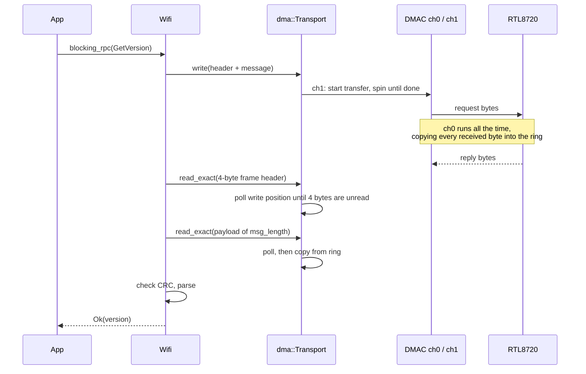
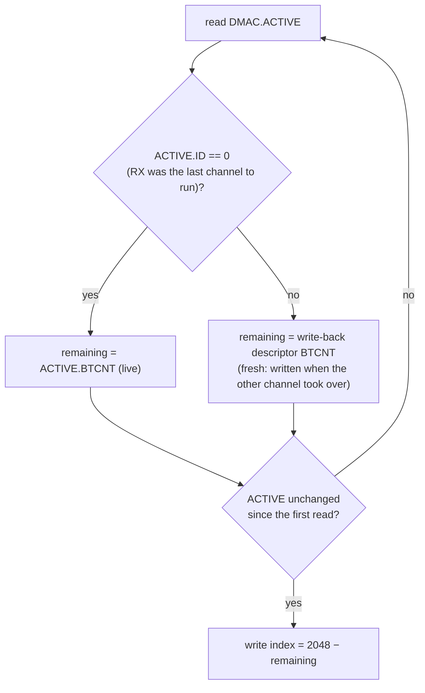
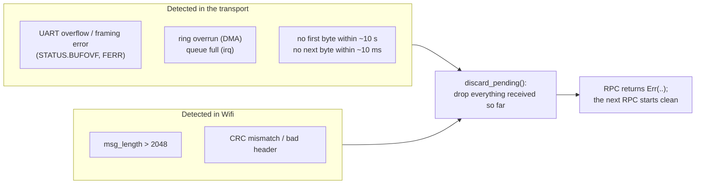
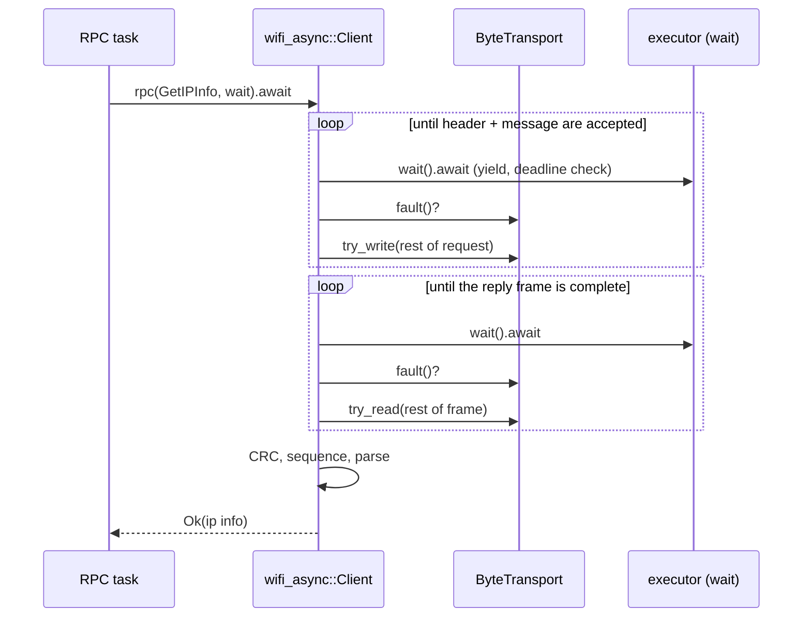
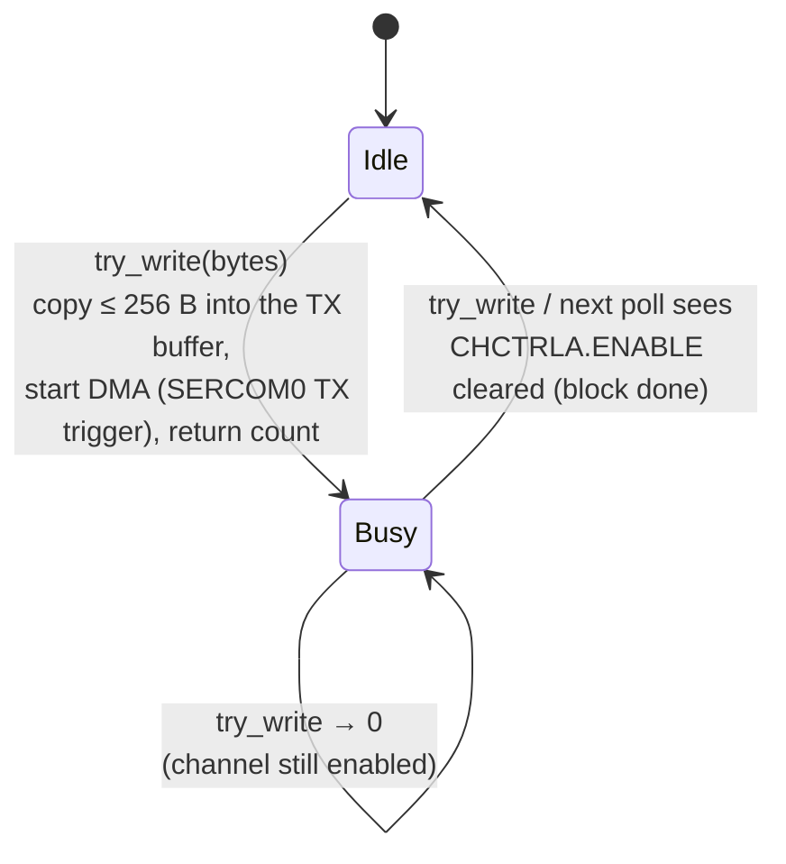

# Wifi DMA transport

How the `wifi-dma` feature moves the Wio Terminal's wifi UART from per-byte
interrupts to DMA, and why it is built the way it is. It covers both clients
of the UART: the blocking `Wifi` RPC API and the async client
(`wifi_async::Client`, see [Async client](#async-client)).

## Why

The SAMD51 talks to the RTL8720 wifi chip through eRPC frames over SERCOM0 at
614400 baud: one byte every 16 µs. The UART's receive buffer holds two bytes,
so with one interrupt per byte, any other interrupt that blocks the CPU for
more than about 30–50 µs makes the receiver overflow and the RPC fails.

With DMA, the hardware moves every byte into RAM by itself. Other interrupts
can block the CPU for as long as they like; the bytes wait in RAM.

| `wifi_bench`, 1 kHz stall interrupt | Interrupt transport | DMA transport |
|---|---|---|
| Get Version round trip (avg) | 1003 µs | 1000 µs |
| ScanGetAP round trip (avg) | 20031 µs | 20033 µs |
| Transport interrupts per Get Version | 35 | 0 |
| CPU in transport interrupts | 4.2 % / 7.1 % | 0 % |
| Stall of 50 µs per ms | 10 of 60 RPCs fail | ok |
| Stall of 100–400 µs per ms | every RPC fails | ok |

Speed is the same: the UART line rate is the limit either way. The gain is
robustness and CPU time. Full numbers: [examples README](../examples/README.md).

## Layers

The RPC layer (`Wifi`) is shared. Only the transport underneath changes, and
the feature picks one at compile time.



Both transports expose the same five methods (`new`, `enable`, `write`,
`read_exact`, `discard_pending`), so `Wifi` has no `cfg` beyond choosing one.
The only API difference is `wifi_init`: with `wifi-dma` it takes the two DMA
channels instead of using two static `BBBuffer`s.

## One RPC on the DMA transport



The CPU still waits for the reply, as it did before: `blocking_rpc` is
blocking by design. The difference is that it waits by polling memory and two
registers, and any interrupt may preempt it for any length of time without
data loss.

## The receive ring

Channel 0 runs one circular transfer for the life of the program: its
descriptor links to itself, so after the 2048th byte it starts again at
index 0. The transport never stops or restarts it.

**Wraps need `BLOCKACT = INT`.** The HAL fills descriptors with
`BTCTRL.BLOCKACT = NOACT`. With that, the transfer-complete flag
(`CHINTFLAG.TCMPL`) is set only when a whole transaction ends, which a
circular transfer never does. On hardware (2026-11-16) channel 2 wrapped with
the flag staying 0, while a one-shot TX channel next to it did set its flag at
the end. So no wrap was ever counted, and every wrap made the write position
appear to jump back by 2048 bytes. Both transports therefore set
`BLOCKACT = INT` on the RX descriptor before starting it (`set_block_flag` in
`dma.rs`). That sets the flag at the end of every block; it raises an
interrupt only if the channel's TCMPL interrupt is enabled, and it does not
stop a channel whose descriptor links to itself.

```text
            read_total % 2048                 write index
                   │                               │
                   ▼                               ▼
 ring  ┌───────────┬───────────────────────────────┬──────────────┐
       │  already  │   unread: written, not yet     │  free / old  │
       │   read    │   consumed by read_exact       │    bytes     │
       └───────────┴───────────────────────────────┴──────────────┘
       0                                                         2047

 written_total = wraps × 2048 + write index      (wraps: counted by DMAC_0)
 unread        = written_total − read_total      (both u32, wrapping)

   unread == 0        → wait (poll again)
   0 < unread ≤ 2048  → copy the next byte
   unread > 2048      → the DMA overwrote unread bytes → Err(Rx), resync
```

Both totals are `u32` counters that wrap. 2048 divides 2³², so
`read_total % 2048` is always the right ring index.

## Reading the write position

This is the subtle part. The DMAC keeps a channel's live beat counter
(BTCNT) internally and copies it to the write-back descriptor in RAM **only
when another channel takes over**. While channel 0 was the last channel to
run, the write-back copy is stale. The plan's first version trusted the live
register only while `ACTIVE.ABUSY` was set, and the second RPC hung waiting
for bytes that had already arrived.



Facts established on hardware while building this:

- `ACTIVE.ABUSY` stays set while channel 0 idles waiting for its next
  trigger, so it cannot be used as "burst finished". Waiting for it to clear
  deadlocks.
- `ACTIVE.BTCNT` keeps channel 0's live count after `ABUSY` clears, as long
  as no other channel has run.

`written_total` adds the wrap count. A wrap can complete between the reads,
before the `DMAC_0` handler has counted it, so a pending transfer-complete
flag counts as one more wrap, and the whole read is retried until the count
and the flag are unchanged around it. If a wrap lands on the exact cycle the
block completes, the total can read one ring length behind for a single
poll. `read_exact` treats a negative `unread` as "nothing new yet", not as an
overrun.

## Errors and resynchronisation

Both transports report errors instead of panicking, and `Wifi` turns them
into RPC errors.



- The two timeouts are counted in polling iterations, because the transport
  owns no timer. The first byte of a reply may take long (`WifiConnect`
  blocks on the RTL8720 until it has associated). Once a frame has started,
  the RTL8720 sends it back to back, so a gap of more than about 10 ms means
  bytes were lost. Both figures are estimates, not calibrated.
- On the interrupt transport, after a UART error, the RX handler must flush
  the receiver (`flush_rx_buffer`). The HAL's `read()` leaves the error flag
  and the data in place, so without the flush every later `read()` fails and
  the RX interrupt fires forever. The old code hid this by panicking.

## Async client

Everything above is about the blocking `Wifi` API, where the caller spins
until the reply is in. Firmware built on a cooperative executor (Embassy, as
in `rust_ot_wio`) cannot spin for up to 10 s, so the crate also has an async
client, `wifi_async::Client`, in `src/wifi/asynchronous.rs`.

### The concept

The client does the same eRPC work as `Wifi` (framing, sequence numbers,
CRC, skipping replies that are not ours), but never blocks. It talks to the
UART through a small non-blocking trait:

```rust
pub trait ByteTransport {
    fn try_write(&mut self, data: &[u8]) -> usize; // bytes accepted, may be 0
    fn try_read(&mut self, data: &mut [u8]) -> usize; // bytes copied, may be 0
    fn fault(&self) -> Option<TransportError>;      // latched RX overflow / UART error
    fn drain(&mut self);                            // drop everything readable
}
```

`Client::rpc(rpc, wait)` loops over `try_write` until the request is out,
then over `try_read` until the reply frame is complete. Between two calls it
awaits `wait()`, a closure supplied by the caller that yields to the executor
(for example, sleeps 1 ms) and returns `false` once the request's deadline
has passed. So the transport is polled, never awaited: it needs no waker and
no interrupt to make progress, only a task that comes back regularly.



Failure rules, the same for both backends:

- A timeout (`wait` returned `false`), a transport fault, a malformed frame or
  a dropped (cancelled) `rpc` future **poisons** the client: every later call
  returns `Error::Unavailable`. A well-formed reply in which the radio reports
  failure (`Error::Rpc(RPCErr)`) does not poison it.
- Recovery is the owner's job: power-cycle the radio (`set_power(false)`,
  wait, `set_power(true)`), clear the latched fault (`reset_fault()`), then
  `Client::recover()`, which calls `drain()` and re-arms the client.

### Two backends, one client

The client is split from the parts that own the hardware. Which pair you get
depends on `wifi-dma`:

| | Interrupt transport (default) | DMA transport (`wifi-dma`) |
|---|---|---|
| Constructor | `Wifi::init(.., &RX, &TX).into_async()` | `Wifi::init_async(.., rx_ch, tx_ch, &mut BUFFERS)` |
| Task side (`ByteTransport`) | `WifiIo`: bbqueue consumer/producer | `WifiIo<RxId, TxId>`: DMA ring reader, TX DMA |
| Owner side | `WifiInterrupts`: UART, power pin, ISR bodies | `WifiControl`: power pin only |
| Interrupts | `SERCOM0_0` → `on_tx`, `SERCOM0_2` → `on_rx`; call `enable` | none |
| Static storage | `BBBuffer<512>` + `BBBuffer<128>` | `WifiDmaBuffers` (2 KiB ring + 256 B TX) |
| DMA channels | none | any two, chosen by the caller |
| Faults latched in | `ASYNC_FAULT` / `LAST_UART_ERROR` | the same statics |

Both owner types have `set_power` and `reset_fault`, and both `WifiIo`s
report the same `TransportError`s, so code above the client changes only in
construction.

### The async DMA transport

`src/wifi/dma_async.rs`. It reuses the receive ring and the write-position
logic of the blocking DMA transport (`dma.rs`,
[Reading the write position](#reading-the-write-position)), with two
differences that come from where it runs.

**It must share the DMA controller.** An async application already runs the
DMAC in `async` mode (`DmaController::into_future`) for other peripherals.
In `rust_ot_wio` that is the OpenTherm edge capture on channels 0 and 1. The
HAL's `async` DMAC interrupt handler runs for every channel that has a
pending *enabled* interrupt (`INTSTATUS` only reports those). On a transfer
complete it **disables the channel** and wakes its waker. A circular receive
with the transfer-complete interrupt on, as the blocking transport uses for
`DMAC_0`, would be stopped at its first wrap. So:

- The two channels are taken from the `async` controller and converted with
  `Channel::into_blocking()`, a small addition to this HAL fork, then
  `init`ed as usual. `init` resets the channel, which leaves all its
  interrupts disabled, and the transport never enables one. The async
  handler never sees these channels.
- The channels are generic (`WifiIo<RxId, TxId>`), so the application picks
  free ones. `rust_ot_wio` uses 2 (RX) and 3 (TX).

**Ring wraps are counted by polling, not by an interrupt.** With
`BLOCKACT = INT` on the descriptor (see [The receive ring](#the-receive-ring))
the channel's transfer-complete flag (`CHINTFLAG.TCMPL`) is set at every wrap,
also while the interrupt is disabled, and it does not show up in `INTSTATUS`
(checked on hardware). `written_total()` (called from `try_read`) takes that
flag:

```text
if TCMPL set:  clear it; wraps += 1        (clear first, then read the position)
written_total = wraps × 2048 + write index
unread        = written_total − read_total (signed)

  unread ≤ 0          → nothing new (also: a wrap that landed between the
                        flag and the position; counted on the next poll)
  0 < unread ≤ 2048   → copy min(unread, wanted) bytes
  unread > 2048       → overwritten: latch RxOverflow
after the copy: re-read written_total; if the DMA lapped the bytes just
copied, latch RxOverflow instead of returning them
```

The flag is only one bit, so this counts correctly as long as the ring wraps
at most once between two polls. During an RPC the client polls on every
`wait()`, about once per millisecond in `rust_ot_wio`, and at 614400 baud
the ring takes about 33 ms to fill. If the task is held off for longer than
that while a reply is arriving, bytes are lost anyway. A double wrap can then
go unnoticed by the count, and the eRPC frame CRC rejects the frame instead.

**Each request starts from a clean ring.** Between RPCs nobody polls, so
the wrap count can fall behind. It doesn't matter: the first `try_write`
after a read phase calls `resync()` (`read_total = written_total()`). Nothing
received before a request is sent can be its reply (late replies to an
abandoned request, callbacks, noise), so dropping it is correct, and the
counting restarts from a consistent base. `drain()` (used by
`Client::recover`) does the same.

**Transmit is a one-shot DMA started from `try_write`.**



The client sends the 4-byte frame header and the message as two
`try_write` calls, so a request is two DMA transfers. Completion is detected
the way the HAL's blocking transfers detect it: the hardware clears the
channel's enable bit at the end of a non-circular block. No interrupt is
needed.

**Faults.** `try_read` checks `SERCOM0.STATUS` (BUFOVF, FERR, PERR) and
latches `TransportError::Uart`, recording the kind for `last_uart_error()`.
A ring overrun latches `TransportError::RxOverflow`. Like the interrupt
backend, a fault stays latched (`try_read`/`try_write` return 0) until
`WifiControl::reset_fault()`.

### Using it

```rust
static mut BUFFERS: WifiDmaBuffers = WifiDmaBuffers::new();

// One `async` DMA controller for the whole firmware.
let channels = DmaController::init(dmac, &mut pm).into_future(DmacIrqs).split();
let rx = channels.2.into_blocking().init(PriorityLevel::Lvl3);
let tx = channels.3.into_blocking().init(PriorityLevel::Lvl0);

let (mut client, mut control) = Wifi::init_async(
    wifi_pins, sercom0, &mut clocks, &mut mclk, &mut delay,
    rx, tx,
    unsafe { &mut *core::ptr::addr_of_mut!(BUFFERS) }, // once
);
// Nothing to enable, no handler to bind.
let ip = client.rpc(rpcs::GetIPInfo { interface: L3Interface::Station }, wait).await;
```

RX gets the highest priority because the UART holds only two received bytes.
In `rust_ot_wio` this is behind its own `wifi-dma` feature
(`src/platform/network.rs`, `platform::ot_ports::dma_channels`).

## Resources

| | Interrupt transport | DMA transport | Async DMA transport |
|---|---|---|---|
| RAM (`wifi_connect` bss) | 708 B | 2576 B (+1868: the 2 KiB ring) | ring + 256 B TX buffer |
| Flash (`wifi_connect` text) | 15000 B | 15564 B | — |
| DMA channels | none | 0 (RX), 1 (TX) | any two (caller's choice) |
| Interrupts | `SERCOM0_0`, `SERCOM0_2` | `DMAC_0` | none |
| Interrupts per received byte | 1 | 1 / 2048 | 0 |
| HAL feature | none | `atsamd-hal/dma` | `atsamd-hal/dma` (+ `async` to share the controller) |

In `rust_ot_wio`'s `boiler_controller` (release build, Wi-Fi + MQTT + log +
cmd + fetch + SD), switching from the interrupt to the async DMA transport
changes text by −360 B and bss by +1648 B.

## Known limits

- **Polling `ACTIVE` and the write-back descriptor** relies on DMAC behaviour
  established on hardware, not on a documented guarantee.
- **The ring is read through a raw pointer** while the HAL's `Transfer` owns
  the `&'static mut` buffer. Only volatile reads are used and no reference to
  the buffer is formed, the same pattern as the HAL's own DMA code.
- **Until 2026-11-16 no ring wrap was counted** (`BLOCKACT = NOACT`, see
  [The receive ring](#the-receive-ring)). The blocking transport hid it: each
  wrap made one RPC time out, `discard_pending` re-based the counters and the
  next RPC worked. Earlier soak-test failures (one failed RPC now and then)
  may have this cause. The async client cannot hide it: a timeout poisons the
  client and costs a radio reset. In `rust_ot_wio` every session died at its
  first wrap, a few seconds after connecting, and the supervisor's backoff
  turned that into ~100 s online and ~3 min 40 s offline.
- **A debugger can cause UART overflows.** `DMAC.DBGCTRL.DBGRUN` is 0 (reset
  value), so the DMAC stops while the debugger halts the core. Attaching
  `probe-rs` repeatedly to read memory (several times a second) produced 4
  `BUFOVF` errors in about 2.5 minutes of traffic; with no probe access, none
  occurred. Set `DBGRUN` if you debug with breakpoints while Wi-Fi is active.
- **A UART overflow can still happen with DMA.** In a 5-minute `wifi_scan`
  soak test, polling `IsScanning` in a tight loop, `SERCOM0.STATUS.BUFOVF`
  occurred within about a minute, losing up to ~8 consecutive bytes. The
  interrupt transport fails the same soak test (queue overrun). The cause is
  unknown. It now produces a failed RPC and a retry, not a hang. Ruled out:
  polling rate, the TX DMA channel, an attached debugger, stale write-back.
  (That test predates the `BLOCKACT` fix above.)
- **The async DMA transport on hardware:** after the fix, `rust_ot_wio`'s
  controller kept its MQTT session through ~15 ring wraps in 5 minutes with
  no transport error (2026-11-16). No long soak test yet.
- **Wrap counting by polling** undercounts if the ring wraps twice between
  two polls during an RPC (task held off for more than ~33 ms while a reply
  arrives). The frame CRC then rejects the corrupted frame.
- **`wifi_singleton!` and `wifi-dma`:** with the feature on, the blocking
  singleton takes channels 0 and 1 and binds `DMAC_0`. That conflicts with
  an application that runs the DMAC in `async` mode, so such an application
  uses only the async transport. Blocking examples built in the same crate
  with `wifi-dma` must pass the DMA channels.
- **Debugging tip:** ending a `probe-rs` session clears `DEMCR.TRCENA`, which
  stops the DWT cycle counter after the firmware enabled it. `wifi_bench`
  re-enables it before each measurement.
